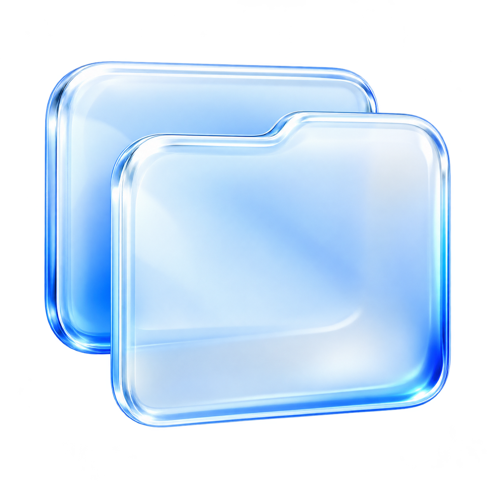
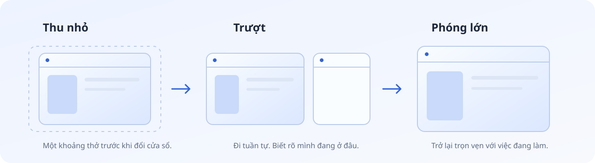

<p align="center">
  
</p>

<h1 align="center">WindowTab</h1>

<p align="center"><strong>Chuyển cửa sổ cũng xứng đáng được mượt.</strong></p>

<p align="center">Một cú vuốt ba ngón. Cửa sổ thu nhỏ, lướt sang bên, rồi mở rộng vào đúng nhịp làm việc của bạn.</p>

<p align="center">
  <a href="https://github.com/nguyenquocan0101/WindowTab/releases/latest"></a>
  
  <a href="LICENSE"></a>
  <a href="https://github.com/nguyenquocan0101/WindowTab/actions/workflows/build.yml"></a>
</p>

<p align="center">
  <a href="https://github.com/nguyenquocan0101/WindowTab/releases/latest/download/WindowTab-win-x64.zip"><strong>Tải WindowTab cho Windows x64 ↓</strong></a>
  &nbsp; · &nbsp; <a href="#quick-start">Bắt đầu sử dụng</a>
  &nbsp; · &nbsp; <a href="docs/quick-start.en.md">English quick start</a>
</p>

---

## Một khoảng thở giữa những cửa sổ

Bạn đang đọc tài liệu, viết vài dòng code, rồi quay lại cuộc trò chuyện. Những lần đổi cửa sổ diễn ra cả ngày. WindowTab dành một chút chăm chút cho chính những khoảnh khắc nhỏ ấy.

Lấy cảm hứng từ cảm giác chuyển cảnh trên MacBook, WindowTab mang một nhịp chuyển **thu nhỏ → trượt → phóng lớn** lên Windows. App ở khay hệ thống, nhận hai phím tắt được gán vào touchpad và đưa bạn đi tuần tự qua các cửa sổ đang mở.



<p align="center"><sub>Minh họa ba giai đoạn chuyển cảnh. Taskbar đứng yên để góc làm việc vẫn có một điểm tựa quen thuộc.</sub></p>

## Những chi tiết làm nên cảm giác

| Điều bạn muốn | WindowTab chăm chút thế nào |
|---|---|
| **Chuyển cửa sổ có nhịp** | Preview thu nhỏ còn 84%, trượt ngang, rồi phóng về đúng kích thước cửa sổ đích. |
| **Biết mình đang ở đâu** | Danh sách giữ thứ tự ổn định trong phiên chạy; cửa sổ mới được thêm vào, cửa sổ đã đóng được bỏ đi. |
| **Chạm cuối là nhận ra** | Ở hai đầu danh sách, preview đi khoảng 20% rồi bật lại. Không quay vòng về cửa sổ đầu. |
| **Taskbar luôn quen thuộc** | Vùng chuyển cảnh nằm trong work area của màn hình, để taskbar đứng yên. |
| **Nhịp chuyển hợp tay mình** | Chỉnh thời lượng và chống lặp bằng ô số, thanh kéo hoặc bàn phím; xem thử ngay trong Cài đặt. |
| **Desktop xuất hiện khi bạn muốn** | Mặc định dừng ở cửa sổ ứng dụng cuối. Có công tắc thêm Desktop ở cuối danh sách. |
| **Mở máy là sẵn sàng** | Tùy chọn khởi động cùng Windows, với cấu hình riêng cho tài khoản của bạn. |

**Giao diện cũng được chăm chút:** logo liquid glass, bốn tab rõ ràng, nút Lưu/Hủy cố định, thanh kéo cobalt và ô nhập thời gian đồng bộ.

<a id="quick-start"></a>

## Bắt đầu sử dụng

### Bạn cần

**Windows 11 x64** và touchpad hỗ trợ gán **Custom shortcut** cho vuốt ba ngón. Khả năng này phụ thuộc driver; một số cử chỉ chỉ hoạt động với Precision Touchpad. [Microsoft giải thích thêm tại đây.](https://support.microsoft.com/en-us/windows/hardware/input-devices/touch-gestures-for-windows)

Gói tải sẵn đã kèm .NET runtime. Bạn không cần cài SDK hay tự build.

### Tải, gán phím, rồi vuốt

1. **[Tải ZIP từ Releases](https://github.com/nguyenquocan0101/WindowTab/releases/latest/download/WindowTab-win-x64.zip)** và giải nén toàn bộ vào một thư mục cố định.
2. **Chạy `Start-WindowTab.cmd`** để mở app và Cài đặt lần đầu. Các lần sau có thể dùng `WindowTab.exe`; icon khay hệ thống có menu **Cài đặt…**, **Tạm dừng gesture**, **Thoát**.
3. **Trong tab Cử chỉ, đọc hai phím tắt đang hiển thị.** Bản cài mới dùng:

   | Vuốt | Phím tắt mặc định |
   |---|---|
   | Trái → cửa sổ kế tiếp | `Ctrl + Alt + Shift + F8` |
   | Phải → cửa sổ trước | `Ctrl + Alt + Shift + F10` |

4. **Giữ Cài đặt WindowTab mở**, bấm **Mở cài đặt Touchpad**. Trong Windows, vào **Bluetooth & devices → Touchpad → Advanced gestures**. Đặt **Swipe left/right → Custom shortcut**, chọn **Start recording**, nhấn đúng tổ hợp tương ứng, rồi **Stop recording**.
5. **Trở về và đóng Cài đặt WindowTab**; bấm **Lưu thay đổi** nếu bạn đã chỉnh gì. Mở ít nhất hai cửa sổ không thu nhỏ trên cùng màn hình và thử vuốt trái, rồi vuốt phải để quay về.

> **Nhớ đóng Cài đặt trước khi vuốt.** WindowTab tạm nhả phím tắt trong lúc cửa sổ này mở để bạn có thể ghi lại tổ hợp trong Windows.

Ngay sau khi khởi chạy, cửa sổ hiện tại là đầu danh sách; vuốt phải lúc đó có thể chỉ bật lại ở biên. Hãy đi tiếp bằng vuốt trái trước.

**[Xem hướng dẫn từng bước, xử lý lỗi và cập nhật app →](docs/getting-started.md)**

## Chọn nhịp làm việc của bạn

| Tab | Bạn có thể làm gì? |
|---|---|
| **Cử chỉ** | Đổi hai phím tắt, mở thiết lập touchpad của Windows. |
| **Chuyển động** | Xem thử hiệu ứng; chỉnh thời lượng **100–600 ms**, chống lặp **0–1000 ms**. |
| **Ứng dụng** | Bật chạy cùng Windows, chọn có thêm Desktop hay không, xem trạng thái kết nối. |
| **Hướng dẫn** | Đọc cách thiết lập ngay trong app. |

Thích phản hồi gọn? Thử **220–300 ms**, chống lặp **100–150 ms**. Muốn nhìn rõ từng giai đoạn? Thử **500–600 ms**, chống lặp **200–250 ms**. Bạn có thể đổi lại bất cứ lúc nào; **Hủy** bỏ chỉnh sửa chưa lưu.

## Hiểu đúng trải nghiệm

- **Đối tượng chuyển:** các cửa sổ ứng dụng như trình duyệt, editor, Discord, File Explorer. Tab bên trong trình duyệt và Windows virtual desktops có cơ chế riêng.
- **Cử chỉ:** Windows/driver nhận dạng thao tác và gửi phím tắt. WindowTab chưa có driver touchpad riêng; chống lặp không thay đổi quãng đường vuốt vật lý.
- **Độ mượt:** bộ hẹn giờ độ phân giải cao nhắm tới **60 lần cập nhật/giây**, giữ tối đa một khung hình giao diện chờ xử lý. FPS hiển thị thực tế còn tùy màn hình, GPU, ứng dụng và tải hệ thống.
- **Phạm vi:** các cửa sổ hiển thị, không thu nhỏ, trên cùng màn hình. Một số cửa sổ được bảo vệ hoặc chạy ở mức quyền khác có thể từ chối preview/focus.
- **Cách dựng hình:** lớp phủ 2D dùng live preview của DWM. Nó không thay đổi trình quản lý cửa sổ hay cài thêm compositor cho Windows.

Nếu một cửa sổ không cho nhận focus, WindowTab trả preview về cửa sổ đang dùng. Nếu preview không khả dụng, app sẽ thử chuyển trực tiếp.

## Cấu hình ở lại trên máy của bạn

App không có tài khoản hoặc máy chủ xử lý hình ảnh. Preview được dựng tại máy bằng DWM; cấu hình và nhật ký nằm trong:

```text
%LOCALAPPDATA%\WindowTab\settings.json
%LOCALAPPDATA%\WindowTab\diagnostics.log
```

Nhật ký ghi mã trạng thái, số lượng cửa sổ và nhịp cập nhật; không ghi tên hay nội dung cửa sổ. Cập nhật phiên bản giữ lại cài đặt đã lưu.

## Khi một cú vuốt chưa như ý

| Hiện tượng | Kiểm tra trước tiên |
|---|---|
| Không chuyển / có tiếng báo | Đóng Cài đặt; kiểm tra Custom shortcut trong Windows khớp hai tổ hợp trong app và đã bấm Stop recording. |
| Chỉ một phía bật trở lại | Có thể bạn đang ở đầu/cuối danh sách; thử phía còn lại. |
| Nhấn phím được, vuốt chưa được | Kiểm tra mapping và driver touchpad trong Windows. |
| Không thấy icon app | Mở vùng icon ẩn ở khay hệ thống; app chỉ chạy một phiên. |
| Không có Custom shortcut | Driver có thể chưa hỗ trợ; thử chức năng chuyển cửa sổ bằng bàn phím. |

Vẫn chưa đúng? [Mở một issue](https://github.com/nguyenquocan0101/WindowTab/issues) kèm phiên bản Windows, touchpad và các bước tái hiện. Phản hồi từ thêm nhiều mẫu máy sẽ giúp những cú vuốt ngày càng tốt hơn.

<a id="build"></a>

## Dành cho người muốn tự build

Trên Windows với **.NET 10 SDK**:

```powershell
git clone https://github.com/nguyenquocan0101/WindowTab.git
cd WindowTab
dotnet build .\WindowTab.csproj -c Release
dotnet run --project .\WindowTab.csproj -- --settings
```

Thoát phiên WindowTab đang chạy trước khi mở bản build khác. Để đóng gói bản x64 có runtime, hướng dẫn và thông báo bản quyền đi kèm:

```powershell
.\tools\Package-Release.ps1 -Version 0.1.0
```

Kết quả là `dist/releases/WindowTab-win-x64.zip` và `SHA256SUMS.txt`. Quy trình Windows build trên GitHub cũng dùng chính script này.

Xem [CONTRIBUTING.md](CONTRIBUTING.md) nếu bạn muốn cải thiện gesture, animation, giao diện hoặc tài liệu.

## Tải từ nguồn chính thức

Bản public đầu tiên chưa ký số. Hãy tải từ [Releases của repo này](https://github.com/nguyenquocan0101/WindowTab/releases) và đối chiếu `SHA256SUMS.txt` khi cần:

```powershell
Get-FileHash .\WindowTab-win-x64.zip -Algorithm SHA256
```

WindowTab được phát hành theo **[MIT License](LICENSE)**. Các thông báo của runtime đi kèm nằm trong thư mục `licenses/` của ZIP; xem thêm [THIRD-PARTY-NOTICES.md](THIRD-PARTY-NOTICES.md). Logo liquid glass được tạo bằng image generation, với [prompt được lưu công khai](Assets/logo-prompt.md).

---

<p align="center"><strong>Một chuyển động nhỏ. Một góc làm việc dễ chịu hơn.</strong><br />Nếu WindowTab hợp tay bạn, một ⭐ sẽ giúp người tiếp theo tìm thấy nó.</p>
